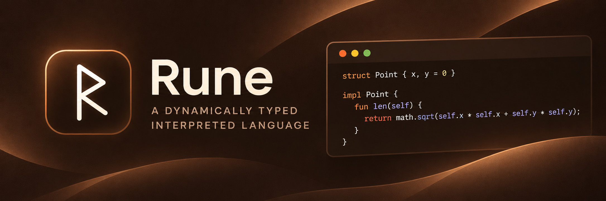
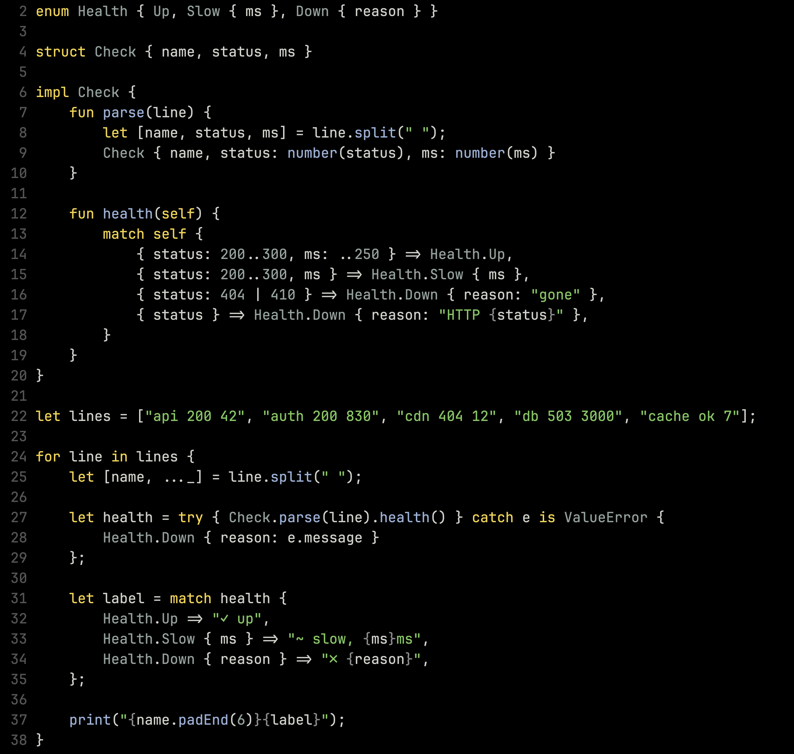

<div align="center">
  
  <p>A small, dynamically typed scripting language with a bytecode VM, shipped as a single static binary.</p>
  <p>
    <a href="https://github.com/kryptamine/rune/actions/workflows/ci.yml"></a>
    <a href="https://github.com/kryptamine/rune/releases/latest"></a>
    <a href="https://kryptamine.github.io/rune/"></a>
    <a href="LICENSE"></a>
  </p>
  <p>
    <a href="https://kryptamine.github.io/rune/"><b>Documentation</b></a> ·
    <a href="https://github.com/kryptamine/rune/releases/latest"><b>Download</b></a> ·
    <a href="examples/"><b>Examples</b></a>
  </p>
</div>

Inspired by JavaScript, Python, Rust and Swift. Written in Go: the AST is
compiled to register bytecode and run by a VM.



```
skip: unknown shape 'hexagon'
skip: int() cannot parse "x" as an integer.
25      Shape.Rect {w: 5, h: 5}
12.56   Shape.Circle {r: 2}
12      Shape.Rect {w: 3, h: 4}
```

## Features

- immutable by default (`let` / `let mut`), compile-time `const`
- value semantics: arrays, objects, maps, sets and structs copy lazily, `mut` parameters are inout
- structs and enums with fields, `impl` methods, `fun f(x) => expr;`
- `match` on literals, ranges (`200..300`, `500..`), types, structs, arrays and enums, exhaustive over enum variants; destructuring, spread, rest
- membership `x in xs` (a range without making it), slices `xs[1..]`, `s[..-1]`
- nil-safe chains `a?.b ?? c`; `return` / `break` / `continue` / `throw` as expressions
- `try`/`catch` by error type, as a statement or an expression; `defer`
- modules with `export` / `import`
- standard library: `string`, `regex`, `math`, `json`, `http`, `time`, `fs`, `io`, `os`
- built-in formatter: `rune fmt`

## Install

Download the archive for your platform from the
[releases page](https://github.com/kryptamine/rune/releases/latest): Linux,
macOS and Windows, on amd64 and arm64. Each holds a single `rune` binary; put
it somewhere on your `PATH`.

```sh
# macOS on Apple silicon; swap the version and platform for yours
curl -LO https://github.com/kryptamine/rune/releases/download/v0.1.0/rune-0.1.0-darwin-arm64.tar.gz
tar -xzf rune-0.1.0-darwin-arm64.tar.gz
sudo mv rune-0.1.0-darwin-arm64/rune /usr/local/bin/
rune version
```

`checksums.txt` next to the archives lists their SHA-256 sums.

### From source

Needs Go 1.27+.

```sh
git clone https://github.com/kryptamine/rune && cd rune
make build
```

## Quick start

```sh
echo 'print("hello, world!");' > hello.rn
rune run hello.rn
```

More programs in [`examples/`](examples). The
[documentation](https://kryptamine.github.io/rune/) covers the language and
the standard library.

## Editor support

Neovim syntax highlighting lives in [`extras/nvim`](extras/nvim).

## Development

```sh
make test          # run the test suite
mdbook serve docs  # preview the docs locally
```

## License

[MIT](LICENSE)
